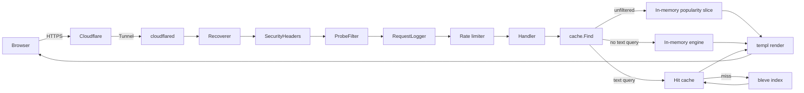
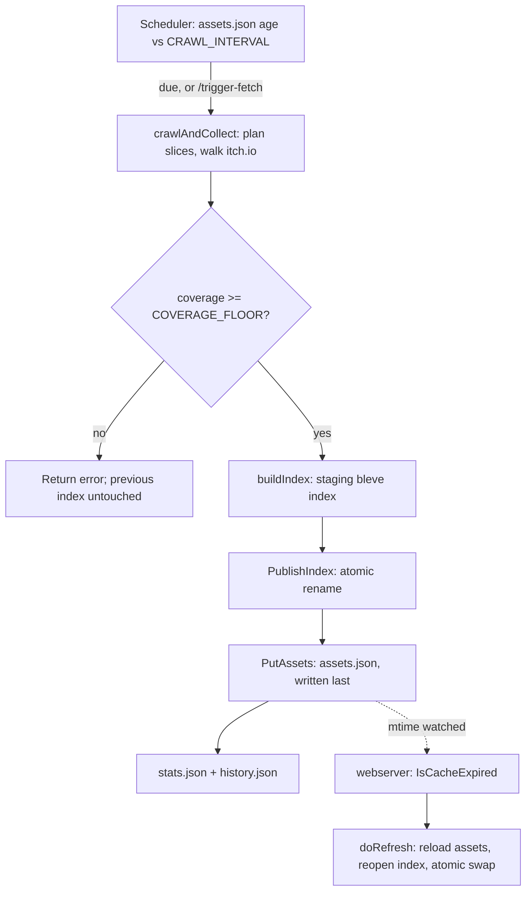

# Architecture

itchgrep is one Go module that builds two programs (Go calls a compiled program a *binary*):

- **`webserver`** — the public-facing program. It serves the search page at itchgrep.com, answers searches, and renders every other page (`/about`, `/stats`, `/new`, `/feed`, `/tag/{slug}`, `/saved`). It never contacts itch.io itself.
- **`dataservice`** — the crawler. On a schedule (or on demand), it walks itch.io's asset catalog, builds a new search index, and publishes it. It has no public pages of its own.

The two programs share one directory on disk (the *data directory*, see [Data lifecycle](#data-lifecycle) below) and nothing else. `dataservice` writes there; `webserver` reads from there. Neither talks to the other over the network in normal operation.

For how to configure either program, see [configuration](configuration.md). For how to deploy them, see [deployment](deployment.md). For infrastructure specifics (the host, Cloudflare Tunnel, ports), see [infrastructure](infrastructure.md).

## Components

| Component | Directory | Responsibility |
|---|---|---|
| webserver entrypoint | `cmd/webserver/` | Starts the HTTP server, wires up routes and middleware, loads the cache at startup. |
| dataservice entrypoint | `cmd/dataservice/` | Runs the crawl scheduler, the crawl itself, self-heals a broken index at startup, exposes `/trigger-fetch`. |
| cache | `internal/cache/` | The webserver's in-memory copy of the published dataset (assets plus the search index), kept fresh by watching `assets.json`. Answers every search and browse request: from memory when there is no text query, from the index when there is one. |
| storage | `internal/storage/` | The only code that reads or writes the shared data directory. Defines the bleve field mapping. Both programs depend on it; it depends on nothing else project-specific. |
| fetcher | `internal/fetcher/` | Everything that talks to itch.io over HTTP: page fetching, rate limiting, the crawl planner, tag discovery. |
| web | `internal/web/` | The webserver's HTTP surface: route handlers, rate limiting, scanner-probe filtering, security headers, access logging, client-IP resolution. |
| templates | `internal/web/templates/` | Rendering: the `templ`-generated HTML plus the plain-Go view models (`Filters`, `Coverage`, `Freshness`, `History`, `Traffic`, the Atom feed, the sitemap, OpenSearch). |
| config | `internal/config/` | Environment-variable parsing shared by both programs, so a setting is never parsed two different ways. |
| metrics | `internal/metrics/` | In-process, no-PII traffic counters that back the public `/stats` page. |
| logging | `internal/logging/` | The one logger both programs write through: leveled text lines plus level-free JSON event lines. |
| models | `pkg/models/` | Data shapes shared by every part of the project: `Asset`, `IndexedAsset`, `Stats`, `CrawlRecord`, `Tag`, `Traffic`. Depends on nothing else in the module. |
| money | `pkg/money/` | Parses itch.io's displayed prices and converts between currencies using a dated exchange-rate snapshot. |

## Project tree

```
cmd/
  webserver/       webserver binary: main.go wires routes; main_test.go
  dataservice/     dataservice binary: main.go (scheduler, crawl), selfheal.go
                    (index self-heal), eta.go (progress-log ETA wording),
                    rates.go (exchange-rate fetch)
internal/
  cache/           in-memory dataset + search (cache.go, search.go)
  config/          shared env-var helpers
  fetcher/         HTTP client to itch.io, rate limiter, planner, tag discovery
  logging/         leveled + JSON-event logger
  metrics/         traffic counters for /stats
  storage/         shared data directory + bleve field mapping
  web/             HTTP handlers and middleware
    templates/     templ views (.templ source, generated *_templ.go) and
                    hand-written Go view models
    static/        embedded CSS, JS, vendored htmx, content hashes (see static/VENDOR.md)
pkg/
  models/          shared data shapes
  money/           price parsing and currency conversion
scripts/           host-side operations scripts (not part of either binary):
                    bootstrap-host.sh, export-logs.sh, update.sh,
                    itchgrep-logrotate.conf — see deployment.md
.github/workflows/ CI — see ci-cd.md
data/              default DATA_DIR for a local `go run`; gitignored
```

For the Go language conventions used throughout `internal/` and `pkg/`, see [languages/go.md](languages/go.md). For how to build and run any of this locally, see [getting-started.md](getting-started.md).

## How a search request flows

A visitor's browser never reaches the `webserver` program directly. Cloudflare sits in front of the site, and a program called `cloudflared` (Cloudflare Tunnel) forwards traffic from Cloudflare to the `webserver` container without opening any inbound port on the host. See [infrastructure](infrastructure.md) for how the tunnel itself is set up.

Inside `webserver`, a request passes through a fixed chain of middleware (`cmd/webserver/main.go`) before it reaches a page handler:

1. **`middleware.Recoverer`** (from the chi router library) — catches a panic anywhere below and still answers something, rather than dropping the connection.
2. **`web.SecurityHeaders`** (`internal/web/secheaders.go`) — sets a Content-Security-Policy and a few other headers on every response.
3. **`web.ProbeFilter`** (`internal/web/probes.go`) — recognizes the shape of a commodity vulnerability scanner (paths like `/wp-admin`, `/.env`, anything ending `.php`) and answers with a bare 404 before the request reaches routing or the access log. It still charges the client one token from the shared per-client rate limiter, so a scanner sweep and real requests from the same client draw on one budget.
4. **`web.RequestLogger`** (`internal/web/logmiddleware.go`) — writes one JSON log line per request that reaches this point.
5. For every route except `/healthz` and `/readyz` — every page, `/results`, `/static/*`, `robots.txt`, `sitemap.xml`, `opensearch.xml`, `favicon.ico`, `security.txt`, and the 404 page — a per-client rate limiter (`internal/web/ratelimit.go`).

From there, a handler in `internal/web/handlers.go` (or `tag.go` for `/tag/{slug}`) parses the query string into a `templates.Filters` value, calls `cache.Find` (`internal/cache/search.go`), and renders the result through `internal/web/templates`.

`cache.Find` decides between three paths (`internal/cache/search.go`):

- An **unfiltered front page** (no query, no tags, popularity order) is served directly from an in-memory slice already sorted by popularity.
- A request **without a text query** (tags, exclusions, price bands, author, a "similar to" tag set, any sort, `/tag/{slug}`, `/new`) is answered by the in-memory engine (`internal/cache/engine.go`). At every refresh the cache derives, from the asset list it already holds, compact per-asset records (interned tag IDs, author ID, price in US dollars as the index stores it, first-seen time) and one precomputed ordering for each of the title, price, recency, and newest-arrival sorts, each ending in the same popularity tiebreak the index applies. A request is then one sequential pass that tests each asset against the filters and counts the total and, when a sidebar is wanted, every match's tags, followed by a walk down the requested ordering that stops when the page is full. That is 2 to 5 ms on 127,000 assets where the index took 130 to 740 ms, because the index spent most of its time visiting doc values for the tag facet and the sort keys. The sidebar ranking (raw counts on an unfiltered request, lift once anything narrows the results) is the same code on either path.
- A request **with a text query** runs against the bleve index, through the hit cache (`internal/cache/hitcache.go`). The cache is a least-recently-used map of 256 entries keyed by the normalized filters minus the page. An entry holds the ordered hits for ten pages, the total, and the ranked sidebar, so the first page of a search pays for the index pass and pages 2 to 10 are slices of the same answer. Concurrent requests for the same key share one pass (single-flight), and every refresh clears the cache and starts a new generation so no answer outlives its dataset. A page past the tenth goes straight to the index. Capped requests (`/feed` with a query) bypass the cache.

The engine and the index must agree on what matches. `internal/cache/parity_test.go` builds a generated catalog through the same indexing code the dataservice uses (`models.NewIndexedAsset`, `storage.IndexMapping`, and the shared `Asset.PriceUSD` conversion) and compares the engine with the index on more than 1,300 random filter combinations: ids in order, totals, and the sidebar. Where popularity ties, the order inside a tie is the index's own accident (it numbers documents in the order it analyzed a batch, a map iteration), so those tests compare sort keys instead of ids.

The tag sidebar renders its first 40 tags in the page. The rest come from `GET /results/tags` (`HandleResultsTags`), a cacheable fragment of `<li>` rows for the same filters that `app.js` fetches when a visitor focuses "Find a tag" or follows "More tags". Without JavaScript "More tags" is a link to the same page with `alltags=1`, which renders every tag server-side; the canonical redirect accepts the parameter (only `PageURL` writes it) and it changes no result.



## How a crawl flows

`dataservice` decides whether to crawl by checking the age of `assets.json` on disk against `CRAWL_INTERVAL`, every 15 minutes (`scheduleCrawls`, `cmd/dataservice/main.go`) — not from a timer that resets on every restart, so a container that gets restarted often still crawls on schedule. The same decision can also be triggered immediately by a `POST /trigger-fetch`.

One crawl, driven by `fetchAndStoreAssets` (`cmd/dataservice/main.go`), runs as a fixed sequence:

1. **Fetch and collect** (`crawlAndCollect`) — reads itch.io's reported catalog size, plans which browsable views ("slices") to walk (`internal/fetcher/planner.go`), and walks them, deduplicating assets by game ID. This stage also resumes an in-progress crawl from a checkpoint if one exists and is fresh enough.
2. **Coverage gate** (`checkCoverageFloor`) — if the crawl collected less than `COVERAGE_FLOOR` of the reported catalog, the run stops here and the previous index is left in place untouched. A stalled or truncated crawl must never replace a good index with a worse one.
3. **Build the index** (`buildIndex`, `cmd/dataservice/selfheal.go`) — converts the collected assets to `models.IndexedAsset` (pricing converted to US dollars using the exchange-rate snapshot fetched this run) and writes a new bleve index at the staging path.
4. **Publish** (`publishCrawl` → `storage.PublishIndex`, then `storage.PutAssets`) — the index is published first, `assets.json` second, deliberately in that order (see [ADR 0005](architecture/decisions/0005-index-before-assets-publish-order.md)).
5. **Record completion** (`recordCrawlCompletion`) — writes `stats.json` (coverage figures) and appends one entry to `history.json`, then deletes the now-stale checkpoint.

The webserver never learns about a new crawl through a signal or a webhook. Each request checks whether the on-disk `assets.json` is newer than what is loaded (`Cache.IsCacheExpired`, `internal/cache/cache.go`), throttled to at most once every 5 seconds so the check costs nothing on the hot path. When it finds a newer file, it reloads the asset list and reopens the bleve index (`Cache.doRefresh`), swapping both in atomically so no in-flight request ever sees a mix of old and new data.



## Data lifecycle

Everything either program persists lives in one directory (`DATA_DIR`, default `./data` for a bare `go run`; `/data` in both containers — `internal/storage/storage.go`). `internal/storage` is the only package that touches it. Every write goes through `writeAtomic` (`internal/storage/storage.go`): write to a temp file in the same directory, `fsync` it, then `os.Rename` it into place, so a concurrent reader never sees a half-written file.

The distinction between **regenerable** and **unregenerable** below matters for [disaster-recovery.md](disaster-recovery.md), which restores these artifacts differently depending on which kind they are.

| Artifact | File name | Written by | Read by | Regenerable? |
|---|---|---|---|---|
| Assets | `assets.json` | `dataservice`, last step of every publish (`storage.PutAssets`, `internal/storage/storage.go`) | `webserver` cache on every refresh; `dataservice` (as `previousAssets`, to carry `FirstSeen` forward and to diff new/removed counts) | Partly. A crawl always produces a fresh `assets.json`. But each asset's `FirstSeen` timestamp is carried forward from the previous publish (`stampFirstSeen`, `cmd/dataservice/main.go`) rather than recomputed. A second file, `firstseen.json`, keeps every id's arrival date across crawls (see its row below), so losing `assets.json` alone no longer resets them. |
| First-seen map | `firstseen.json` | `dataservice`, after `assets.json` is stored (`storage.PutFirstSeen`) | `dataservice` (`stampFirstSeen`) | **No** if `assets.json` is lost too. An id absent from one crawl keeps its `FirstSeen`; it is forgotten only after 6 consecutive published crawls miss it, so one partial crawl cannot make an old asset look new on `/new` and in the feed. If the file is missing or fails to parse (it is moved aside as `firstseen.json.corrupt-<unix>` and an error is logged), the next crawl seeds it from `assets.json`'s `FirstSeen` values. If both are lost, every asset's arrival date resets to "first seen in the next crawl." |
| Tag universe | `tags.json` | `dataservice`, after tag discovery (`storage.PutTags`) | `dataservice` (reuses the cache instead of rediscovering); `webserver` cache (`/tag/{slug}` validation, sitemap) | Yes. Rediscovered automatically when missing or older than `TAG_CACHE_MAX_AGE` — costs several hundred requests to itch.io (see [glossary: tag universe](glossary.md#tag-universe)). |
| Crawl checkpoint | `checkpoint.json` | `dataservice`, periodically during a crawl (`crawler.checkpoint`); deleted on successful publish | `dataservice`, to resume an interrupted crawl (`crawler.resume`) | Yes, and short-lived by design. Losing it only means the next crawl starts from scratch instead of resuming. |
| Exchange rates | `rates.json` | `dataservice`, once per crawl (`currentRates`, `cmd/dataservice/rates.go`) | `dataservice` (fallback source if a rebuild can't refetch); `webserver` cache (`Rates()`, and the dollar values baked into the index) | Yes. Refetched from the ECB every crawl; falls back to the built-in table (`money.Fallback()`) if both the live fetch and the stored file are unavailable. |
| Crawl coverage stats | `stats.json` | `dataservice`, at the end of a successful publish (`recordCrawlCompletion`) | `webserver` cache (the coverage line in the masthead) | Yes. Recomputed by the next successful crawl. |
| Public traffic counters | `traffic.json` | `webserver`, on a timer (every 5 minutes) and once more on graceful shutdown (`internal/metrics`) | `webserver`, restored into `metrics.Counters` at startup | **No.** This is the webserver's own visitor-count history (aggregate counts only — no IP addresses, no query text). Nothing about it is derived from a crawl, and a crawl cannot reconstruct it. Losing it resets every counter to zero and resets "counting since" to the moment of loss. |
| Crawl history | `history.json` | `dataservice`, one entry appended per successful publish (`storage.PutHistory`), capped at 104 entries (~2 years of weekly crawls) | `webserver` handler, read directly from storage for the `/stats` history table (`internal/web/handlers.go`) | **No.** Each entry is a record of one specific crawl run (when, how long it took, how many assets, how many 429s, and so on) that cannot be reconstructed after the fact. |
| Search index | `index.bleve/` | `dataservice`, via `buildIndex` + `storage.PublishIndex` (atomic three-rename swap, see [ADR 0005](architecture/decisions/0005-index-before-assets-publish-order.md)) | `webserver` cache (`bleve.Open`) | Yes, fully. Rebuildable from `assets.json` + `rates.json` alone, with no need to recrawl itch.io — see [ADR 0008](architecture/decisions/0008-self-healing-index-rebuild.md), which automates exactly this at `dataservice` startup. |
| Staging index | `index.bleve.staging/` | `dataservice`, while `buildIndex` is running | Nobody directly; it exists only to be renamed into place by `PublishIndex`, or deleted on a failed build | Yes — purely transient. Always safe to delete if found orphaned; the next crawl clears it before building. |
| Previous index (transient) | `index.bleve.previous/` (only exists mid-publish) | `dataservice`, briefly, as the middle step of `PublishIndex`'s crash-safe three-rename sequence (`internal/storage/storage.go`) | Nobody; it is either restored (on a failed publish) or deleted (on success) before `PublishIndex` returns | Yes — purely transient and self-cleaning. A copy left behind by a hard crash mid-publish is cleared automatically at the start of the next `PublishIndex` call. |

For what happens if any of these is missing, corrupted, or needs to be restored from a backup, see [disaster-recovery.md](disaster-recovery.md).
